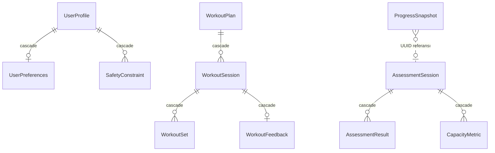

# 02 — iOS Teknik Mimari, Klasör Yapısı ve SwiftData Şeması

## 1. Teknoloji seçimleri

| Alan | Seçim | Not |
|---|---|---|
| Dil | Swift 5 dil modu + `SWIFT_STRICT_CONCURRENCY=complete` | Swift 6 dil moduna Faz 6'da geçiş (uyarılar sıfırlandıktan sonra) |
| UI | SwiftUI | UIKit yalnızca kamera önizleme köprüsü için (`UIViewRepresentable` + `AVCaptureVideoPreviewLayer`) |
| Minimum iOS | 17.0 | SwiftData, `@Observable`, `sensoryFeedback`, `VNDetectHumanBodyPose3DRequest` için gerekli |
| Araç zinciri | Xcode 16+ | Swift Testing ve `@Entry` makrosu için |
| Kalıcılık | SwiftData (`VersionedSchema` + `SchemaMigrationPlan`) | Baştan sürümlü |
| Poz analizi | Vision `VNDetectHumanBodyPoseRequest` (2D) | 3D istek yalnızca opsiyonel deney |
| Kamera | AVFoundation `AVCaptureSession` + `AVCaptureVideoDataOutput` | Kareler bellekte işlenir, diske yazılmaz |
| Grafik | Swift Charts | |
| Abonelik | StoreKit 2 | Sunucu yok; `Transaction.currentEntitlements` + `Transaction.updates` |
| Sağlık | HealthKit | Ayrı ayrı, bağlamsal izin |
| Test | Swift Testing (birim) + XCTest (UI) | |
| Proje üretimi | XcodeGen (`project.yml`) | `.xcodeproj` git'e girmez → merge çakışması yok |
| 3. taraf bağımlılık | **Yok** | |

## 2. Katmanlar

```
┌──────────────────────────────────────────────┐
│ UI (SwiftUI Views)                           │  Sunum, erişilebilirlik, yerelleştirme
├──────────────────────────────────────────────┤
│ Presentation (@Observable @MainActor models) │  Ekran durumu, kullanıcı aksiyonları
├──────────────────────────────────────────────┤
│ Domain Services (saf Swift, Sendable)        │  SafetyEngine, PlanGenerator, Progression,
│                                              │  CapacityScoring, ReassessmentPolicy, RepCounter
├──────────────────────────────────────────────┤
│ Repository (protokoller)                     │  WorkoutRepository, AssessmentRepository…
├──────────────────────────────────────────────┤
│ Local Storage / Apple Frameworks             │  SwiftData, Vision, AVFoundation, HealthKit, StoreKit
└──────────────────────────────────────────────┘
```

**Kurallar**
- Domain servisleri SwiftUI/SwiftData import **etmez**; değer tipleri (`struct`, `enum`) alır ve döndürür. Böylece mantığı simülatör olmadan test edebiliriz. Bu kod Windows'taki Swift araç zincirinde bile derlenip test edilebilir.
- Güvenlik kararları yalnızca `Safety` modülündeki deterministik kurallarda verilir. `PlanGenerator` ham sonuç üretir, `SafetyEngine` bu sonucu onaylar, değiştirir ya da reddeder.
- Bağımlılıklar ya initializer ile ya da SwiftUI `EnvironmentValues` (`@Entry`) ile enjekte edilir. Global singleton kullanılmaz. Testlerde `FixedClock`, in-memory `ModelContainer`, sahte StoreKit (`.storekit` yapılandırma dosyası) kullanılır.
- **Modülerlik:** Faz 1'de tek uygulama hedefi altında özellik klasörleri kullanılıyor. Domain katmanı büyüdüğünde (Faz 2–3) `StrengthspanDomain` adlı yerel Swift Package'a taşınır; derleyici o noktadan sonra UI → Domain yönünü zorunlu kılar. Erken paketleme bu aşamada fayda sağlamadan karmaşıklık eklerdi.

## 3. Klasör yapısı

Faz 1'de oluşturulan dosyalar **kalın** gösterilmiştir. Diğer klasörler ilgili fazda eklenecektir. Boş klasör oluşturulmamıştır.

```
STRENGTHSPAN/
├── **project.yml**                      XcodeGen proje tanımı
├── **README.md**
├── docs/                                Bu belgeler
├── Strengthspan/
│   ├── App/                             (AppCore)
│   │   ├── **StrengthspanApp.swift**    @main, bootstrap
│   │   ├── **AppBootstrap.swift**       Container oluşturma + hata durumu
│   │   ├── **RootView.swift**           Tab navigation
│   │   └── **StartupErrorView.swift**
│   ├── Core/
│   │   ├── **AppClock.swift**           Zaman soyutlaması (DI)
│   │   ├── **AppEnvironment.swift**     EnvironmentValues girdileri
│   │   ├── **LaunchArgument.swift**
│   │   ├── **Logging.swift**            os.Logger kategorileri
│   │   └── Domain/
│   │       ├── **DomainTypes.swift**    Kalıcı enum'lar (raw değerleri sabit)
│   │       └── **ReassessmentPolicy.swift**
│   ├── DesignSystem/
│   │   ├── **SSColor.swift**  **SSTypography.swift**  **SSLayout.swift**
│   │   ├── **SSButtonStyles.swift**  **SSCard.swift**  **SSEmptyState.swift**
│   │   └── **DesignSystemGallery.swift** (yalnızca DEBUG)
│   ├── Persistence/
│   │   ├── **PersistenceController.swift**
│   │   ├── **PersonalDataEraser.swift**
│   │   ├── **PreviewSupport.swift**     (yalnızca DEBUG — önizleme verisi)
│   │   └── Schema/
│   │       ├── **SchemaV1.swift**  **SchemaV1+Profile.swift**  **SchemaV1+Workout.swift**
│   │       ├── **SchemaV1+Assessment.swift**  **SchemaV1+Progress.swift**
│   │       ├── **ModelAliases.swift**  **MigrationPlan.swift**
│   ├── Features/
│   │   ├── Today/**TodayView.swift**
│   │   ├── Progress/**ProgressDashboardView.swift**
│   │   ├── Settings/**SettingsView.swift**
│   │   ├── Onboarding/        (Faz 2)
│   │   ├── Workout/           (Faz 2)  Player, Feedback
│   │   ├── Assessment/        (Faz 3)  Akış ekranları
│   │   └── Subscription/      (Faz 5)  Paywall
│   ├── Content/               (Faz 2)  ExerciseCatalog, AssessmentCatalog (bundled JSON)
│   ├── Safety/                (Faz 2)  SafetyEngine, ScreeningRules
│   ├── Progression/           (Faz 2)  PlanGenerator, ProgressionRules
│   ├── PoseAnalysis/          (Faz 3)  CameraSession, PoseExtractor, RepCounter, QualityGate
│   ├── Capacity/              (Faz 4)  CapacityScoring, ComparabilityRules
│   ├── HealthIntegration/     (Faz 6)
│   └── Resources/
│       ├── **Assets.xcassets**  **Localizable.xcstrings**  **PrivacyInfo.xcprivacy**
│       └── Info.plist         (XcodeGen tarafından üretilir)
├── StrengthspanTests/         **Swift Testing birim testleri**
└── StrengthspanUITests/       **XCTest UI testleri**
```

## 4. Veri modelleri — tasarım kararları

### 4.1 İçerik verisi ve kullanıcı verisi ayrımı

| Tür | Modeller | Depolama | Neden |
|---|---|---|---|
| **Kullanıcı verisi** | UserProfile, UserPreferences, SafetyConstraint, WorkoutPlan, WorkoutSession, WorkoutSet, WorkoutFeedback, AssessmentSession, AssessmentResult, CapacityMetric, ProgressSnapshot | SwiftData | Kişiye ait; dışa aktarılır ve silinir |
| **Uygulama içeriği** | Exercise, ExerciseVariant, AssessmentDefinition | Swift kodunda sürümlü statik katalog (`Content/ExerciseCatalog.swift`, `version`) | Uygulama güncellemesiyle gelir. Derleme sırasında doğrulanır ve Windows'ta da test edilebilir. Veritabanına kopyalamak gereksiz migrasyon riski yaratırdı. *(Faz 2 kararı: başta düşünülen JSON yerine Swift; içerik büyürse JSON'a taşınabilir)* |
| **Türetilmiş durum** | SubscriptionEntitlement | Bellekte, StoreKit'ten türetilir | Gerçeğin kaynağı imzalı StoreKit işlemleridir. Yerel kopya tutmak manipülasyona ve bayat duruma açık olurdu |

Kullanıcı verisi içeriğe **sabit string anahtarlarla** referans verir (`exerciseKey`, `variantKey`, `assessmentKey`, `definitionVersion`). Katalog değişse bile geçmiş kayıtlar anlamını korur.

### 4.2 Enum saklama stratejisi

Enum'lar `xxxRaw: String` olarak saklanır ve tipli bir computed property ile açılır. Bunun iki nedeni var:
- `#Predicate` içinde string karşılaştırması güvenilir biçimde çalışır.
- Bilinmeyen bir değer (ör. uygulamanın eski sürümüne geri dönüldüğünde) çökme yerine güvenli bir varsayılana düşer.

**Raw değerleri asla değiştirilmez.** `DomainTypesTests` bunu test eder.

### 4.3 Şema (SchemaV1)



| Model | Önemli alanlar | Yaşam döngüsü |
|---|---|---|
| **UserProfile** | `id`, `ageRangeRaw`, `activityLevelRaw`, `experienceLevelRaw`, `primaryGoalRaw`, `screeningOutcomeRaw`, `safetyScreeningCompletedAt`, `onboardingCompletedAt` | Onboarding'de oluşur. Tek kayıt. Silme işlemi tüm verileri siler |
| **UserPreferences** | `weeklySessionTarget`, `sessionLengthMinutes`, `equipmentRaw[]`, `preferredWeekdays[]`, `voiceGuidanceEnabled`, `hapticsEnabled` | Profille 1-1 ilişkili, cascade |
| **SafetyConstraint** | `kindRaw`, `bodyRegionRaw`, `sourceRaw`, `reportedAt`, `resolvedAt?`, `note?` | Onboarding veya antrenman geri bildiriminden oluşur. Silinmez; `resolvedAt` ile kapanır (denetlenebilirlik) |
| **WorkoutPlan** | `weekStartDate`, `generatorVersion`, `statusRaw` | Haftalık oluşur. Yeni plan gelince eski plan `superseded` olur |
| **WorkoutSession** | `scheduledDate`, `plannedDurationMinutes`, `startedAt?`, `completedAt?`, `statusRaw` | planned → inProgress → completed / skipped / stoppedForSafety |
| **WorkoutSet** | `exerciseKey`, `variantKey`, `blockRaw`, `orderIndex`, `setNumber`, hedef/gerçek tekrar-süre-yük (kg), `restSeconds` | Seansla cascade |
| **WorkoutFeedback** | `rpe`, `discomfortRaw`, `discomfortRegionsRaw[]`, `dizzinessReported`, `completionRaw`, `note?` | Seans sonunda oluşur. Progresyonun girdisidir |
| **AssessmentSession** | `startedAt`, `completedAt?`, `statusRaw`, `isBaseline`, `deviceModel`, `appVersion` | `completedAt` yalnızca `markCompleted` ile set edilir (değişmez kural) |
| **AssessmentResult** | `assessmentKey`, `definitionVersion`, `methodRaw`, `statusRaw`, `value?`, `unitRaw`, `reliabilityRaw`, `qualityFlagsRaw[]`, `usedSupport`, `setupVariant` | Değişmez kayıt. Karşılaştırılabilirlik = aynı key + version + setupVariant + usedSupport + geçerli durum |
| **CapacityMetric** | `dimensionRaw`, `score?` (nil = yetersiz veri), `reliabilityRaw`, `scoringModelVersion`, `computedAt` | Değerlendirmeden türetilir. Puanlama modeli sürümü değişirse yeniden hesaplanabilir |
| **ProgressSnapshot** | `periodStart`, `periodEnd`, `baselineSessionID?`, `currentSessionID?`, `plannedSessions`, `completedSessions` | 28 günlük dönem kapandığında oluşur. Rapor ve geçmiş için kullanılır |

Kodun tamamı `Strengthspan/Persistence/Schema/` altında yer alıyor.

### 4.4 Migrasyon

- Her model `SchemaV1` namespace'i içinde tanımlanır; uygulama kodu `typealias` üzerinden erişir (`ModelAliases.swift`).
- Yeni sürüm şu adımlarla eklenir:
  1. `SchemaV2` dosyaları oluşturulur.
  2. `ModelAliases` V2'ye yönlendirilir.
  3. `StrengthspanMigrationPlan.schemas` ve `stages` listelerine ekleme yapılır (mümkünse `.lightweight`, gerekiyorsa `.custom`).
  4. Bir migrasyon testi yazılır: V1 store oluşturulur ve V2 ile açılır.
- **CloudKit notu (v1.2+):** CloudKit `@Attribute(.unique)` desteklemez ve tüm ilişkilerin opsiyonel olmasını ister. İlişkiler zaten opsiyonel tanımlı. Senkronizasyon eklenirken V2'de `unique` kaldırılacak ve tekilleştirme uygulama mantığına taşınacak.

### 4.5 Veri koruması, dışa aktarma, silme
- Store, Application Support altında iOS varsayılan veri korumasıyla (Complete Until First User Authentication) tutulur. Faz 6'da `NSFileProtectionComplete` değerlendirilecek (arka planda HealthKit yazımıyla çakışma riski kontrol edilmeli).
- **Silme:** `PersonalDataEraser` tüm kullanıcı modellerini siler (Faz 1'de hazır ve test edildi).
- **Dışa aktarma:** Faz 6'da `Codable` DTO'larla JSON üretilecek ve `ShareLink` ile paylaşılacak.

## 4.6 Faz 2 bileşenleri

| Katman | Dosya | Görev |
|---|---|---|
| İçerik | `Content/Exercise.swift`, `ExerciseCatalog.swift` | 17 hareket, 33 varyant. Yalnızca ayakta veya sandalyede yapılan, yere inmeyi gerektirmeyen hareketler. Her varyant için yüklenen bölgeler ve destek bilgisi tutulur |
| Güvenlik | `Safety/Screening.swift`, `SafetyEngine.swift` | Tarama, plan izni, ağrılı bölge filtresi, denge seviye tavanı, geri bildirim ve durdurma kararları |
| Progresyon | `Progression/ProgressionEngine.swift` | Geçmişten yeniden hesaplanan seviye/tekrar durumu (saklanan gizli durum yok) |
| Plan | `Progression/PlanGenerator.swift` | 7 günlük plan: şablon (10/20/30 dk), rotasyon, geri dönüş haftası, süre kırpma (+%10) |
| Köprü | `Persistence/TrainingStore.swift` | Plan üretimi/saklama, geri bildirim, güvenlik kısıtları, yeniden planlama |
| UI | `Features/Onboarding`, `Features/Workout`, `Features/Today` | Onboarding, Workout Player (sesli yönlendirme, zamanlayıcı, dinlenme), geri bildirim, güvenlik ekranları |

Güvenlik, progresyon ve plan kodu yalnızca Foundation kullanır. Bu sayede Windows'taki Swift araç zincirinde de derlenip test edilir.

## 5. Eşzamanlılık
- UI ve `ModelContext.mainContext` → `@MainActor`.
- Vision işleme ayrı bir seri `DispatchQueue` (video output delegate) üzerinde çalışır. Sonuçlar `Sendable` değer tipleri (`PoseFrame`) olarak ana aktöre aktarılır.
- Arka planda yoğun yazma gerekirse `@ModelActor` kullanılır (MVP'de beklenmiyor).
